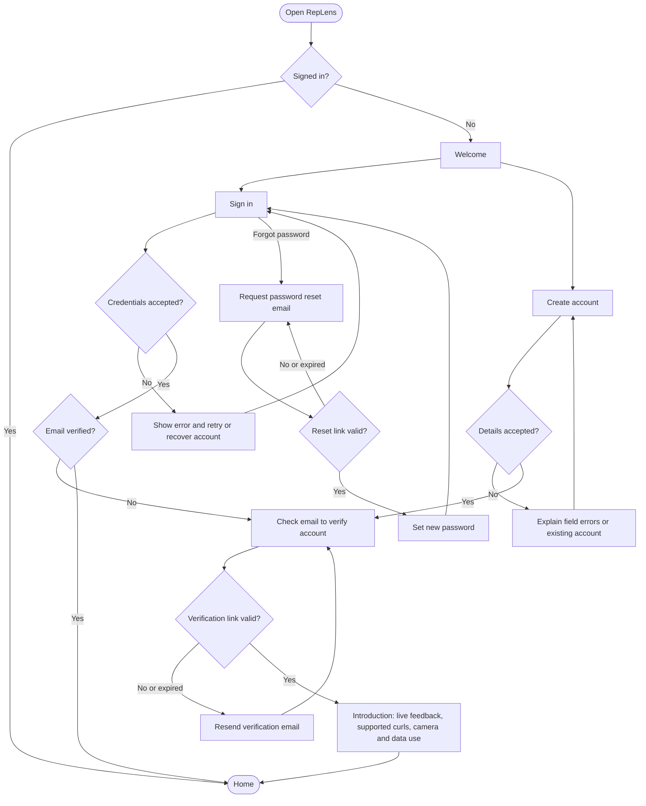
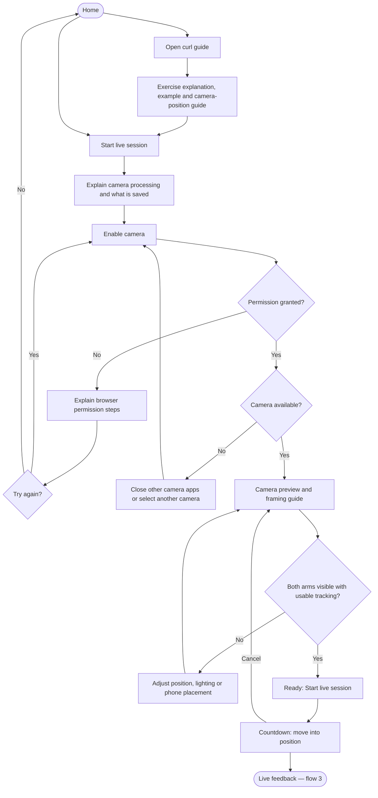
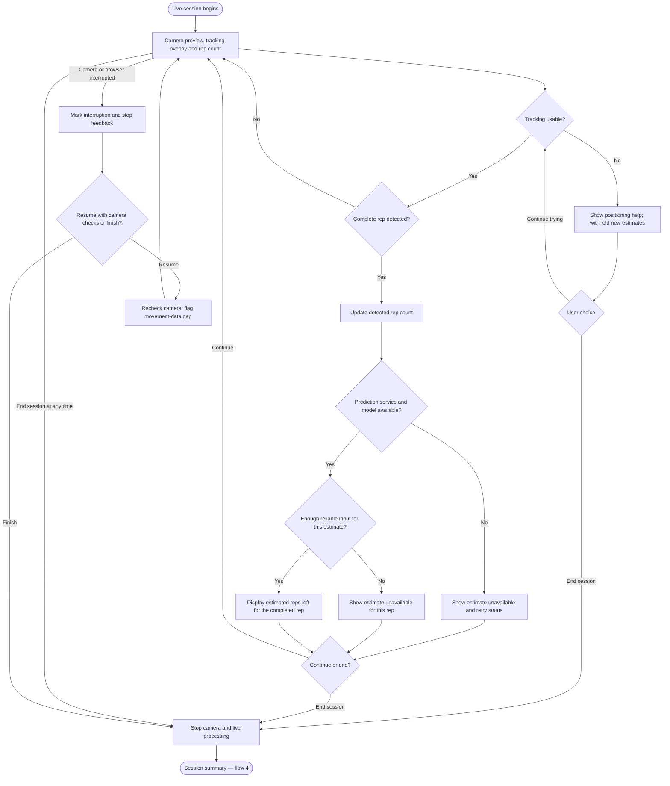
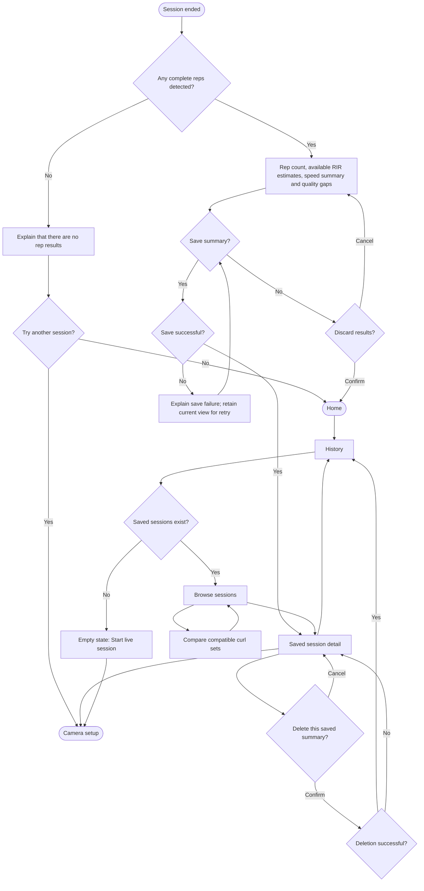
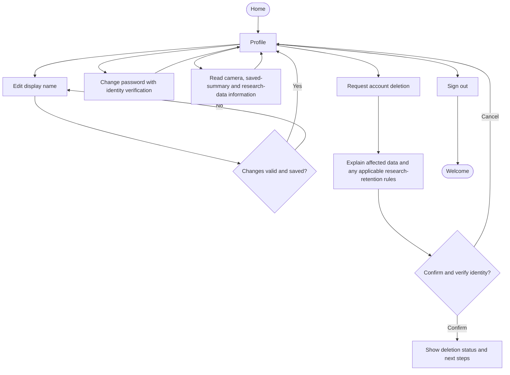

# RepLens user flows — review draft

Planned mobile web experience; these diagrams describe intended behavior, not implemented functionality.

Destination board: https://www.figma.com/board/WGyMKSzknb1WjZQKjZk1fG/Untitled

Current scope is the lifter-facing app. A researcher workspace is out of scope for now.

Main navigation: **Home · Live session · History · Profile**. Exercise guides are accessible from Home and camera setup. Supported live analysis starts with simultaneous two-arm dumbbell curls.

Use rounded nodes for entry/exit, rectangles for screens/actions, diamonds for decisions, and labeled branches. On FigJam, arrange the numbered flows in separate sections with consistent colors: neutral screens, teal successful outcomes, amber decisions, and coral recovery paths. Each diagram has a local Home node to avoid long lines across the board.

## 1. Account access and introduction

## 2. Exercise guide and live-session setup

The data-use wording must match the eventual implementation. The live-session name does not promise on-device processing or no storage. No automatic research enrollment.

## 3. Live feedback and recovery

If predictions use a server, loss of connection must make stale estimates visibly unavailable. Do not invent missing reps or treat an interrupted interval as observed movement. The model must use only information available by the current rep. Actual phone performance and the feedback-delay target require testing.

## 4. Summary and history

Saving a summary does not mean saving video. Video replay is available only where an explicitly disclosed, permitted video-save option exists; it is not assumed for ordinary live sessions.

## 5. Profile and privacy

## Decisions to resolve during implementation

- Actual phone versus server processing and behavior when connectivity is lost.
- Whether ordinary live sessions offer optional video saving at all; storage, disclosure and deletion must match the decision.
- Exact account-deletion and research-retention handling under the approved protocol.
- How much interrupted movement history each tested model needs before reliable predictions can resume.

These are review decisions, not completed product capabilities.
